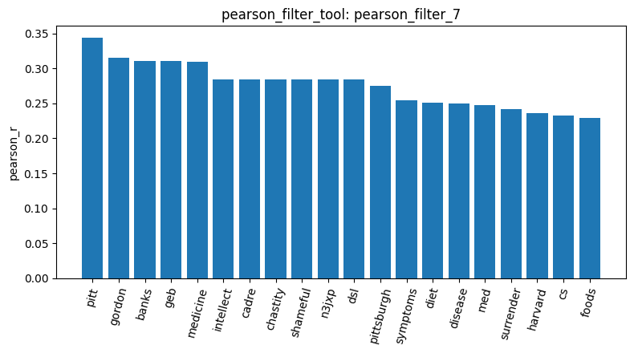
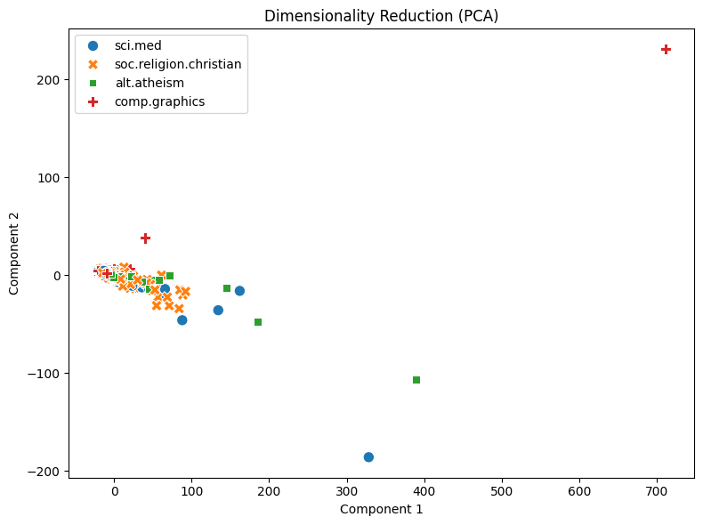

# Agentic Pipeline Report

I loaded 2,257 documents from four 20-newsgroups categories: alt.atheism, comp.graphics, sci.med, and soc.religion.christian (load_dataset_1). Initial checks found no missing text or duplicate documents (check_missing_3; check_duplicates_4). I sampled 500 documents with random_state=42 (sample_data_2). Tool fixes required restarting the Pipeline, so this report references results across sessions; the same sampling seed restored the working subset. After changing max_df to a proportion-only parameter, the rebuilt DTM contained 16,283 terms and 81,463 non-zero entries, with 98.9994% sparsity (dtm_3). Previously, max_df=1 had been interpreted as a document-count cutoff and incorrectly retained only terms appearing in a single document.

The term-frequency results were dominated by common words because the global DTM retained stopwords (term_frequency_4). Variance filtering at 0.01 identified 4,525 features above the threshold (variance_filter_6). For sci.med, Pearson and Spearman filtering at 0.1 identified 530 and 551 features respectively (pearson_filter_7; spearman_filter_8). These tools reported selections without changing the global DTM. The Pearson plot included pitt, gordon, banks, geb, and medicine among its leading terms, suggesting that author or signature information influenced the associations alongside topic vocabulary.

I ran category-specific TF-IDF filtering followed by FPGrowth with min_sup=20 for all four categories. The previews included cause in sci.med (mine_patterns_10, before the restart), file in comp.graphics (mine_patterns_4), believe in alt.atheism (mine_patterns_5), and sin with god in soc.religion.christian (mine_patterns_6). Many patterns also contained subject, lines, or organization, showing the influence of message headers. The summaries contained only the first 20 patterns, so their lengths were not the total pattern counts. A Windows encoding error encountered during comp.graphics mining was corrected by using temporary ASCII item IDs and mapping results back to the original terms.

PCA explained 70.04% and 7.92% of variance in its first two components (reduce_dimensions_7). Most documents overlapped, while a few outliers stretched the plot. UMAP and t-SNE also showed considerable mixing between categories (reduce_dimensions_8; reduce_dimensions_9). These plots therefore did not demonstrate clear separation into four groups.

Finally, one-hot encoding produced a 500×4 matrix (binarize_labels_10). Documents 0 and 1 had cosine similarity 0.2600 (cosine_similarity_11), indicating some overlap in their count-vector representations. Important limitations are the retained headers, raw count features, and the use of a 500-document sample. The t-SNE tool produced a plot, but its fixture coordinates still failed Known Answer 8; that validation issue remains unresolved.
