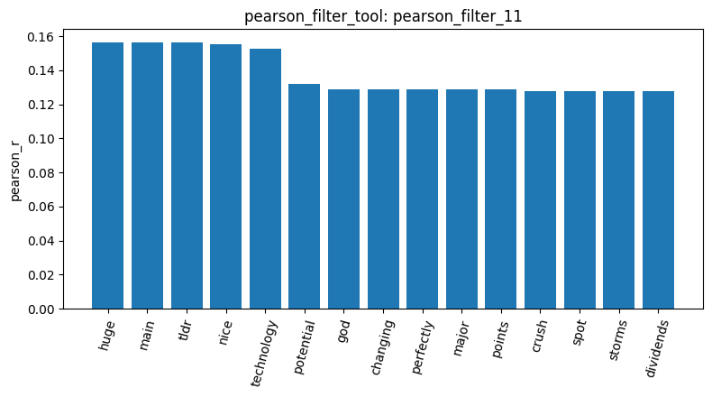
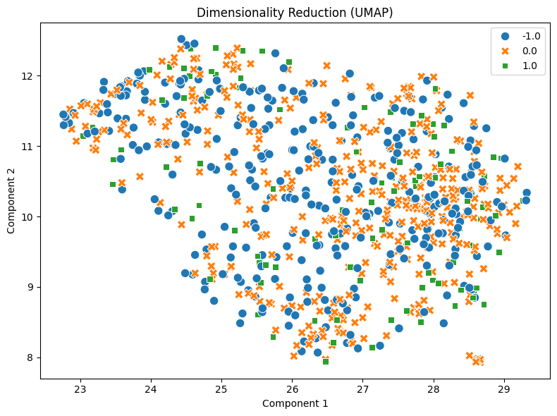
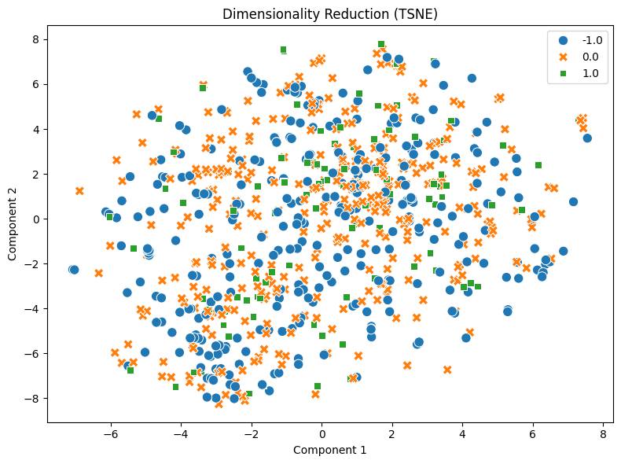

# Homework Report: Reddit Stock Sentiment

I applied my tools to Reddit stock-sentiment data rather than the topic-labeled 20-newsgroups corpus. Loading produced 847 posts: 315 negative (-1.0), 423 neutral (0.0), and 109 positive (1.0), with no missing text (load_dataset_1; check_missing_3). Checking duplicates counted 23 extra copies; dropping with keep=False removed all 34 rows belonging to duplicate groups, leaving 813 posts (check_duplicates_4; check_duplicates_5). The cleaned counts were 315 negative, 391 neutral, and 107 positive. Mean character length was 148.3087, median 80, and maximum 2,753 (describe_data_6; [length boxplot](../plots/陳蔚榑_homework_plot_describe_data_6.png)). Short posts and class imbalance distinguish this dataset from the longer newsgroup articles. API access problems forced a kernel restart; I restored the same 813 posts (check_duplicates_2 in the restarted session). Results below use the original session IDs unless explicitly marked as restarted.

Using all cleaned posts, I built a unigram count DTM with min_df=1 and max_df=1.0: 813 × 4,313, with 16,659 non-zero entries and 99.5249% sparsity (dtm_7). The restarted dtm_3 reproduced these metrics. Common words dominated term_frequency_8, led by the (874), to (554), and and (471). The [DTM heatmap](../plots/陳蔚榑_homework_plot_dtm_heatmap_9.png) showed an almost empty slice of alphabetically early numeric terms; this slice is not a summary of sentiment vocabulary. Variance filtering at 0.01 retained 490 features (variance_filter_10). For positive sentiment, Pearson and Spearman thresholds of 0.1 retained 41 and 39 features respectively (pearson_filter_11; spearman_filter_12), without replacing the global DTM. The Pearson plot included huge, main, tdr, nice, and technology. These are sample associations, not evidence of causation or reliable sentiment predictors. I also generated the top-20 variance term correlation heatmap (feature_correlation_matrix_13); the agent omitted numerical coefficients in its explanation, so I do not claim an exact ranking of the strongest pairs.

I ran per-category TF-IDF filtering and FPGrowth with min_sup=10. The positive preview contained good (support 12) and just (15), while the negative preview included good (13), trade (14), tariffs (16), and economy (17) (mine_patterns_14; mine_patterns_15). The neutral preview included stocks (12), company (13), and tariffs (13), together with noisy tokens such as x200b and ve (mine_patterns_16). Supports count documents within each category; unequal class sizes prevent direct comparison of raw counts. The appearance of good in both positive and negative posts also shows why individual words cannot determine sentiment. These previews are not total pattern counts. Compared with newsgroup mining, which often returned message-header combinations, Reddit results included trading vocabulary and informal tokenization artifacts.

PCA explained 26.70% and 5.12% of variance in its first two components (reduce_dimensions_17; [PCA plot](../plots/陳蔚榑_homework_plot_reduce_dimensions_17.png)), less than the 70.04% and 7.92% in the earlier 500-document newsgroup analysis. The Reddit PCA plot showed overlapping classes and several outliers. UMAP with n_neighbors=15 and random_state=42 also mixed the three sentiments (reduce_dimensions_18). After the restart, t-SNE with perplexity=30 and random_state=42 produced another overlapping projection (restarted reduce_dimensions_4). None of these plots demonstrates clear sentiment separation or measures classification accuracy. The t-SNE tool ran successfully here, but its separate Known Answer 8 coordinate mismatch remains unresolved.

Finally, one-hot encoding produced an 813 × 3 matrix ordered [-1.0, 0.0, 1.0] (restarted binarize_labels_5). Documents 0 and 1 had cosine similarity 0.0 using the stored count vectorizer (restarted cosine_similarity_6), indicating no shared non-zero vocabulary terms in this representation, not necessarily different sentiments. The tools therefore operated on the new dataset without Homework-specific code changes, but raw word counts lose context, negation, and sarcasm. Class imbalance, residual noisy tokens, and removing every copy of duplicate text also limit interpretation. Further work should compare text cleaning and normalized features and evaluate sentiment prediction on held-out data rather than infer performance from these exploratory plots.
